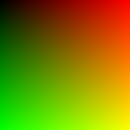

# CUDA Ray Tracer

- [Abstract](#abstract)
- [Hardware and Software](#hardware-and-software)
- [Sample .ppm image using CUDA](#sample-.ppm-image-using-cuda)
- [References](#references)

## Abstract

Implementation of a ray tracer using NVIDIA CUDA.

## Sample .ppm image

[image.ppm](src/iamge.ppm)

## Hardware and Software

- **OS:** Arch Linux
- **Kernel:** 7.2.8-arch1-2
- **CPU:** Intel Core i7-13700K (13th Gen)
- **CPU cores:** 24 logical CPUs (16 physical cores)
- **RAM:** 62 GiB
- **GPU:** NVIDIA GeForce RTX 3080
- **GPU VRAM:** 10 GiB
- **NVIDIA Driver:** 615.71.09
- **CUDA Toolkit:** 13.4
- **GCC:** 16.2.1

## References

- [Ray Tracing in One Weekend](https://raytracing.github.io/books/RayTracingInOneWeekend.html)
